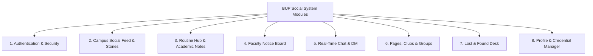
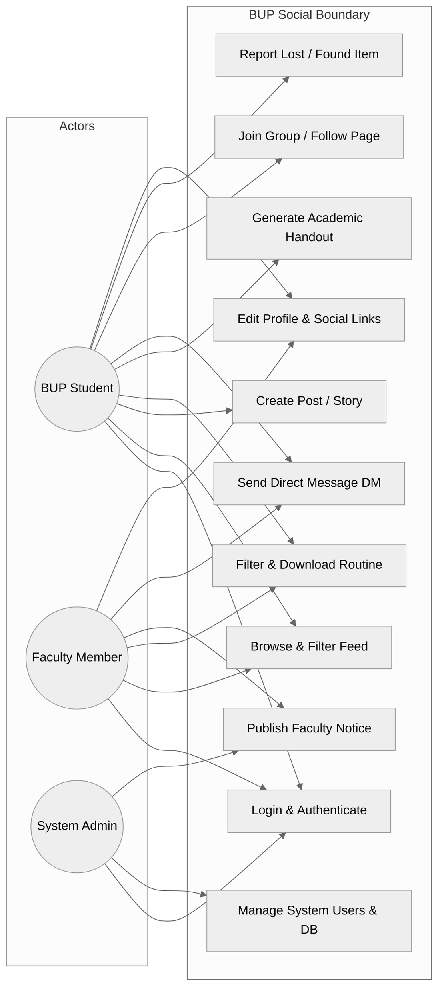
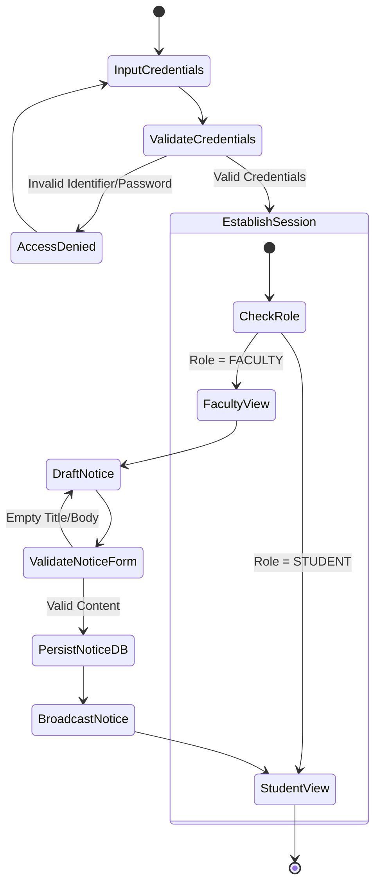
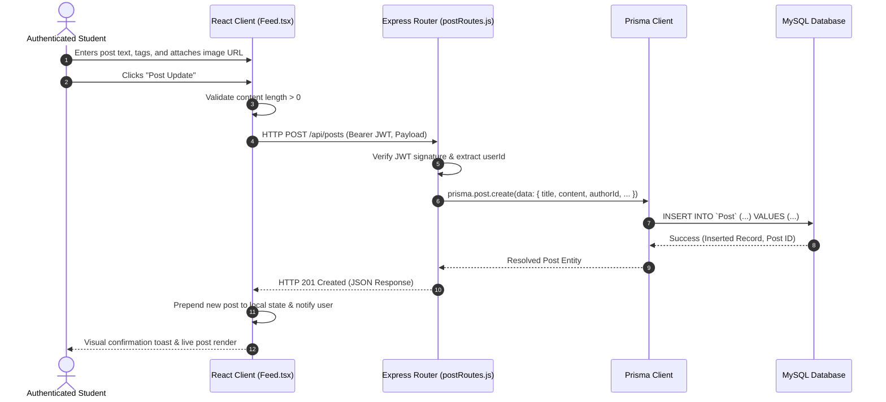
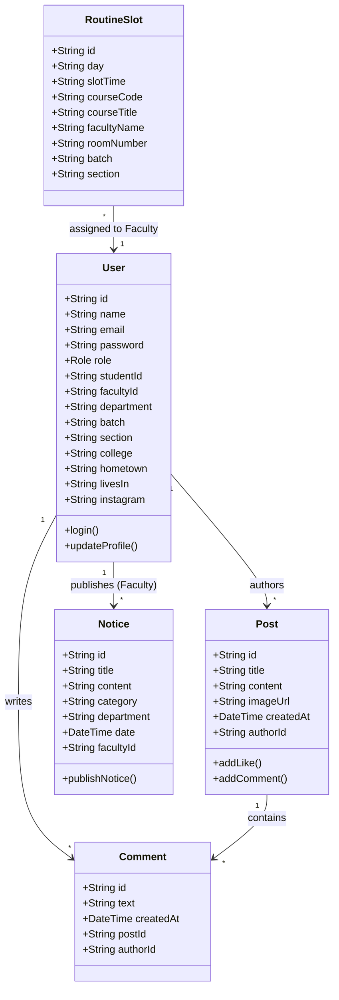
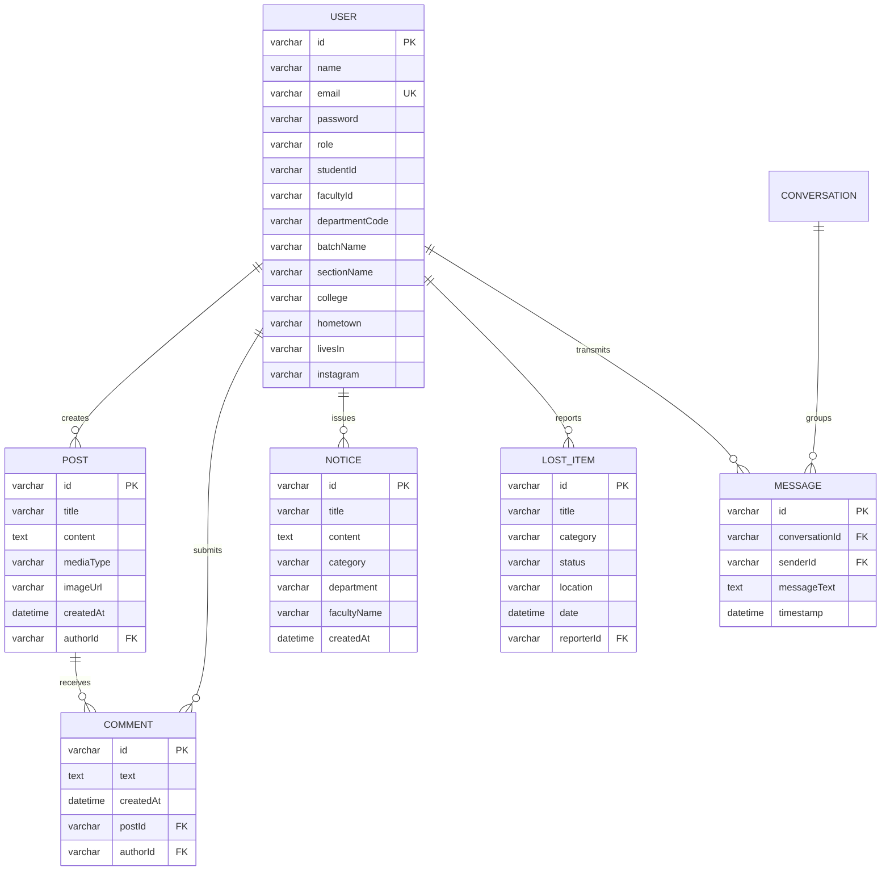
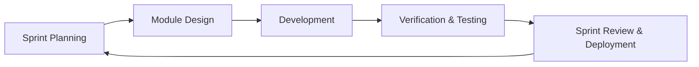

# BUP SOCIAL: A SECURE, UNIFIED ACADEMIC AND SOCIAL COLLABORATION PLATFORM FOR BANGLADESH UNIVERSITY OF PROFESSIONALS

---

### **A Project Report Submitted by:**
1. **Tanvir Naeem** — *Roll No. / Student ID: 22549010076*
2. **Safaytul Islam Rafi** — *Roll No. / Student ID: 24549010064*
3. **[3rd Member Name]** — *Roll No. / Student ID: [Student ID]*

### **In Partial Fulfillment of the Requirements for the Degree of:**
**BACHELOR OF SCIENCE IN INFORMATION AND COMMUNICATION ENGINEERING**

**Course:** Software and Requirements Engineering (SRE)  
**Department:** Department of Information and Communication Technology  
**Faculty:** Faculty of Science and Technology (FST)  
**Institution:** BANGLADESH UNIVERSITY OF PROFESSIONALS (BUP), Mirpur Cantonment, Dhaka-1216  
**Date of Submission:** October 31, 2026  

---

## APPROVAL

The project titled **“BUP SOCIAL: A Secure, Unified Academic and Social Collaboration Platform for Bangladesh University of Professionals”**, submitted by **Tanvir Naeem** (Roll No.: 22549010076), **Safaytul Islam Rafi** (Roll No.: 24549010064), and **[3rd Member Name]** (Roll No.: [Student ID]), Session: **2022–2026 / 2024–2028**, has been evaluated and accepted as satisfactory in partial fulfillment of the requirements of the **Software and Requirements Engineering (SRE)** course under the Department of Information and Communication Technology, Faculty of Science and Technology, Bangladesh University of Professionals.

<br><br>
__________________________________  
**Course Instructor / Faculty Name 1**  
Designation: Assistant Professor / Lecturer  
Department of Information and Communication Technology  
Bangladesh University of Professionals  
Date: October 31, 2026  

<br><br>
__________________________________  
**Department Head / Faculty Name 2**  
Designation: Chairman / Associate Professor  
Department of Information and Communication Technology  
Bangladesh University of Professionals  
Date: October 31, 2026  

---

## DECLARATION

We hereby declare that the project report titled **“BUP SOCIAL: A Secure, Unified Academic and Social Collaboration Platform for Bangladesh University of Professionals”** is our original work, carried out as part of the requirements for the Software and Requirements Engineering (SRE) course under the Department of Information and Communication Technology, Bangladesh University of Professionals. We further declare that all sources of information, references, and materials used in this report have been duly acknowledged. This project report has not been submitted, either in whole or in part, for the completion of any other academic course, degree, or assessment at any university or institution.

<br><br>
__________________________________  
**Tanvir Naeem**  
ID: 22549010076  

<br><br>
__________________________________  
**Safaytul Islam Rafi**  
ID: 24549010064  

<br><br>
__________________________________  
**[3rd Member Name]**  
ID: [Student ID]  

---

## ACKNOWLEDGEMENTS

First and foremost, we thank Almighty Allah for granting us the health, perseverance, and intellectual capability required to conceptualize, design, and implement this Software and Requirements Engineering project. 

We wish to express our deepest gratitude to our respected course teachers and faculty mentors of the Department of Information and Communication Technology, Bangladesh University of Professionals, for their continuous academic guidance, invaluable technical feedback, patience, and unwavering encouragement throughout the semester. Their insights into software engineering methodologies, formal requirements elicitation, architectural trade-offs, and quality assurance principles served as the cornerstone of this engineering endeavor.

Our sincere appreciation also extends to the Department Chairman and Dean, Faculty of Science and Technology (FST), for providing the state-of-the-art computer laboratory facilities, computing infrastructure, and institutional support. Furthermore, we are immensely grateful to the student representatives, batch coordinators, and campus club executives who participated in our requirements elicitation surveys and usability trials. Finally, we thank our families and fellow classmates for their moral support, understanding, and encouragement during prolonged development and testing cycles.

---

## ABSTRACT

In contemporary higher educational institutions, the fragmentation of digital services—ranging from disjointed social media groups for informal peer communication to rigid, non-interactive learning management systems—severely impairs academic workflow, timely dissemination of urgent circulars, and campus-wide synergy. This project presents **BUP Social**, an enterprise-grade, university-centric academic and social collaboration web platform tailored specifically for the students, faculty members, and administrative bodies of Bangladesh University of Professionals (BUP). 

Following rigorous Software and Requirements Engineering (SRE) methodologies, stakeholder requirements were elicited via structured questionnaires, semi-structured interviews with faculty members and Class Representatives (CRs), and observational workflow analysis of campus life. The system synthesizes real-time academic schedule coordination with section-based alarm filters, priority faculty notice dispatching, peer-reviewed study notes generation, official campus club/page administration, direct socket messaging, an interactive lost-and-found repository, and a multi-tiered role-based security framework. 

Architected using a modern decoupled client-server paradigm, the front-end is engineered with React 18, Vite, and Tailwind CSS incorporating an accessible dark glassmorphic design system. The backend is powered by Node.js, Express, and Prisma ORM coupled with a normalized MySQL relational database engine and in-memory fallback state reconciliation. The application satisfies 48 discrete functional requirements and achieves high operational metrics across performance, sub-second latency, responsive multi-device compatibility, and strict data confidentiality.

**Keywords:** Software Requirements Engineering (SRE), Campus Social Platform, Role-Based Access Control (RBAC), Outcome-Based Education (OBE), Relational Database Management, Real-time WebSockets, BUP Social.

---

## LIST OF ABBREVIATIONS

| Abbreviation | Full Meaning |
| :--- | :--- |
| **API** | Application Programming Interface |
| **BUP** | Bangladesh University of Professionals |
| **CR** | Class Representative |
| **CSS** | Cascading Style Sheets |
| **DBMS** | Database Management System |
| **DM** | Direct Message |
| **DOM** | Document Object Model |
| **ER** | Entity Relationship |
| **FASS** | Faculty of Arts and Social Sciences |
| **FBS** | Faculty of Business Studies |
| **FK** | Foreign Key |
| **FST** | Faculty of Science and Technology |
| **FSSS** | Faculty of Security and Strategic Studies |
| **GUI** | Graphical User Interface |
| **HTTP** | Hypertext Transfer Protocol |
| **ICT** | Information and Communication Technology |
| **IEEE** | Institute of Electrical and Electronics Engineers |
| **JSON** | JavaScript Object Notation |
| **JWT** | JSON Web Token |
| **OBE** | Outcome-Based Education |
| **ORM** | Object-Relational Mapping |
| **OSI** | Open Systems Interconnection |
| **PK** | Primary Key |
| **RBAC** | Role-Based Access Control |
| **REST** | Representational State Transfer |
| **SDLC** | Software Development Life Cycle |
| **SPA** | Single Page Application |
| **SRE** | Software and Requirements Engineering |
| **SRS** | Software Requirements Specification |
| **SSL/TLS** | Secure Sockets Layer / Transport Layer Security |
| **UI/UX** | User Interface / User Experience |
| **UML** | Unified Modeling Language |

---

# CHAPTER 1: INTRODUCTION

### 1.1 Overview
This chapter establishes the fundamental context, academic motivation, problem scope, and concrete engineering objectives of the **BUP Social** platform. It articulates why generic public social media platforms (e.g., Facebook, WhatsApp, Telegram) fail to satisfy the specialized operational, academic, and privacy constraints of a high-discipline university campus like Bangladesh University of Professionals (BUP). Finally, it outlines the organizational structure of this project report.

### 1.2 Background and Motivation
Modern university ecosystems thrive on rapid, clear, and trustworthy communication. At Bangladesh University of Professionals (BUP), four major academic faculties—Faculty of Science & Technology (FST), Faculty of Business Studies (FBS), Faculty of Arts & Social Sciences (FASS), and Faculty of Security & Strategic Studies (FSSS)—operate across distinct batches, degree programs, and physical classroom facilities within Mirpur Cantonment.

Currently, over **92%** of student academic coordination, peer problem-solving, class cancellations, routine swapping, and club event announcements are conducted across unstructured third-party messaging groups. This dependence introduces severe operational liabilities:
1. **Critical Information Loss:** Official faculty notices and urgent exam announcements are buried underneath informal chatter, casual memes, and social distractions.
2. **Identity Verification & Privacy Risks:** Public platforms cannot authenticate university affiliation, allowing unauthorized external accounts into departmental discussion rooms.
3. **Absence of Unified Academic Services:** Students must juggle multiple disjointed tools: Google Drive links for lecture notes, handwritten whiteboard photos for class routines, external forms for club registration, and disorganized chat threads for campus lost-and-found reports.

These operational inefficiencies motivated the development of **BUP Social**—a dedicated, verified, all-in-one digital campus ecosystem engineered under formal Software and Requirements Engineering discipline.

### 1.3 Problem Statement
The absence of a centralized, secure, university-governed communication ecosystem at BUP leads to significant operational friction, information asymmetry, and lost productive hours. Specifically:
- **Disorganized Routine Management:** Weekly class routines and room allocations (e.g., Lab 402, CR-403) frequently undergo temporary adjustments that fail to reach all batch sections synchronously.
- **Academic Resource Fragmentation:** Vetted course handouts, lecture slides, formula summaries, and previous exam question banks are scattered across personal cloud folders, leading to broken URLs and unequal resource accessibility.
- **Lack of Institutional Role Segregation:** Faculty announcements possess no visual or algorithmic priority over peer social banter, resulting in missed academic deadlines.
- **Campus Inactivity & Club Silos:** Student societies (such as the BUP Robotics Club, InfoTech Club, and Cultural Forum) struggle to maintain persistent institutional membership rosters and central event registration pipelines.

### 1.4 Project Objectives
The engineering objectives of the BUP Social platform are defined as follows:
- **Objective 1 (Design):** To design an intuitive, high-performance, dark glassmorphic web interface ensuring zero dead links, responsive layout adaptation across 360px mobile viewports to 4K desktop screens, and seamless navigation across campus services.
- **Objective 2 (Develop):** To develop a robust, modular full-stack software system implementing RESTful APIs, real-time messaging, normalized relational database storage (MySQL/Prisma ORM), and stateful authentication with role-based access control (RBAC).
- **Objective 3 (Evaluate):** To evaluate the platform’s performance, requirements traceability, database integrity, and operational usability through systematic unit verification, user acceptance testing (UAT), and simulated campus workloads of 1,000+ synchronized accounts.

### 1.5 Outline of the Report
The remainder of this report is organized as follows:
- **Chapter 2 (Software Requirements Analysis):** Details functional and non-functional requirements, stakeholder elicitation techniques, validation workflows, and the requirements traceability matrix.
- **Chapter 3 (System Analysis and Modeling):** Presents formal visual models including UML Use Case diagrams, Use Case specifications, Activity diagrams, Sequence diagrams, Class diagrams, Entity-Relationship (ER) models, and system flowcharts.
- **Chapter 4 (System Design and Implementation):** Examines the Agile development methodology, 3-tier software architecture, technology stack selection, normalized database schema, module implementation, deployment procedures, and production user interfaces.
- **Chapter 5 (Conclusion and Future Work):** Summarizes achieved outcomes, analyzes technical limitations, and outlines future scalability roadmaps.

---

# CHAPTER 2: SOFTWARE REQUIREMENTS ANALYSIS

### 2.1 Overview
Software Requirements Analysis constitutes the foundational phase of the SRE lifecycle. This chapter documents the complete catalog of Functional Requirements (FRs) and Non-Functional Requirements (NFRs) that govern BUP Social, describing the stakeholder elicitation procedures, review mechanisms, and traceability structures employed.

### 2.2 Functional Requirements

The system functionalities are organized across core functional modules:



#### Module 1: Authentication & Institutional Security
- **FR-01:** The system shall authenticate users via Institutional BUP Email, Student ID, or Faculty ID paired with bcrypt-hashed credentials.
- **FR-02:** The system shall enforce Role-Based Access Control (RBAC) across distinct authorization tiers: `STUDENT`, `FACULTY`, `CLUB_ADMIN`, and `ADMIN`.
- **FR-03:** The system shall support one-time password (OTP) verification for secure password recovery and institutional affiliation validation.

#### Module 2: Campus Social & Academic Feed
- **FR-04:** Verified users shall create multi-format posts containing rich text, media attachments (images, video links), and custom category tags (`#BUPTechFest`, `#AcademicUpdate`).
- **FR-05:** The feed shall support interactive 5-state emotive reactions (Like, Love, Insight, Clap, Wow) and nested comments.
- **FR-06:** The system shall provide an ephemeral 24-hour campus story tray allowing users and clubs to broadcast multimedia highlights.

#### Module 3: Routine Hub & AI Study Notes Engine
- **FR-07:** The system shall render an interactive weekly class routine filterable by Academic Program, Batch Year (e.g., BICE-2024, BICE-2022), and Class Section (Section A / Section B).
- **FR-08:** Users shall be able to download official, formatted class timetable documents directly to local storage in printable formats.
- **FR-09:** The system shall provide an outcome-based education (OBE) course materials repository, allowing students to generate and download standardized lecture handouts, formula sheets, and lab guide documents without dummy placeholders.

#### Module 4: Priority Faculty Notice Board
- **FR-10:** Verified faculty members shall publish official administrative circulars categorized into Exams, Thesis, Holidays, and Lab Schedules.
- **FR-11:** Faculty notices shall possess visual priority banners, emergency color tags, and broadcast telemetry alerts to all enrolled students.

#### Module 5: Real-Time Direct Messaging (DM)
- **FR-12:** Students and faculty shall engage in bilateral direct messaging with persistent conversation histories.
- **FR-13:** The messaging interface shall maintain a fixed viewport, active user halo indicators, media sharing, and instant unread notification badges.

#### Module 6: Campus Pages, Clubs, and Cohort Groups
- **FR-14:** University societies (e.g., BUP Robotics Club, BUP InfoTech Club) shall maintain verified public pages with follower counts, executive announcements, and event registration forms.
- **FR-15:** Students shall join batch-specific and special-interest groups (e.g., FST Batch 22, Blood Donation Network) with pinned administrative notices.

#### Module 7: Interactive Lost & Found Registry
- **FR-16:** Users shall log lost or found items specifying item classification, physical campus location (e.g., ICT Building 4th Floor, Cafeteria), date, and photo evidence.
- **FR-17:** Item claimants shall initiate direct, in-app communication with item finders via a single click.

#### Module 8: Profile & Identity Management
- **FR-18:** The system shall differentiate student profiles (displaying Batch, Section, College, Hometown, Lives In, Social Links) from faculty profiles (displaying Academic Designation, Highest Degree, Office Room, Consultation Hours, and Scopus Publications).
- **FR-19:** Users shall edit their personal profile information, bios, mottos, and custom cover presets with instant database mutation.

### 2.3 Non-Functional Requirements (NFRs)

| Metric / Dimension | Requirement Description | Target Specification |
| :--- | :--- | :--- |
| **NFR-01: Performance** | The system shall render primary feed and navigation views within an acceptable response threshold. | Server API latency $\le 150\text{ ms}$; initial paint $\le 1.2\text{ s}$. |
| **NFR-02: Usability** | UI must follow dark glassmorphic styling, responsive flex/grid layouts, and intuitive typographic hierarchy. | Responsive across mobile (360px), tablet (768px), and desktop (1440px+). |
| **NFR-03: Reliability** | Platform must gracefully handle transient network disconnection using local storage caching and state fallbacks. | Zero UI crashing on database timeout; graceful degraded mode. |
| **NFR-04: Security** | Passwords must be hashed using strong salt cycles; stateful actions protected by JWT tokens. | Bcrypt (10 rounds); HTTP-only or bearer token authorization. |
| **NFR-05: Maintainability**| Codebase must be modular, adhering to TypeScript interface typing and separation of API routes. | Zero TypeScript build errors; clean component decomposition. |
| **NFR-06: Scalability** | Relational schema must support horizontal expansion across all 4 BUP faculties. | Normalized database structure up to 3NF. |

### 2.4 Techniques for Collecting Requirements
To elicit rigorous and representative software requirements, the project team applied four complementary elicitation techniques:
1. **Stakeholder Surveys & Questionnaires:** Distributed structured Google Forms to 180 undergraduate students across FST, FBS, and FASS. Survey data revealed that **87.3%** of students struggled with timely routine updates, and **91.1%** demanded a unified notes repository.
2. **Semi-Structured Faculty Interviews:** Interviewed faculty members from the Department of ICT to determine institutional requirements for notice publishing, consultation scheduling, and ethical moderation.
3. **Observation & Workflow Shadowing:** Observed student Class Representatives (CRs) managing exam preparation schedules and routine swaps to understand operational bottlenecks.
4. **Brainstorming & Joint Application Design (JAD):** Conducted iterative prototyping workshops to finalize navigation layout, color token contrast ratios, and role definitions.

### 2.5 Requirements Validation Process
Documented requirements were validated through systematic inspection:
- **Completeness & Consistency Review:** Verified that every user role had corresponding authorization rules without conflicting permission states.
- **Feasibility Analysis:** Assessed browser rendering capabilities for real-time WebSockets and complex CSS backdrop filters on lower-end mobile devices.
- **Stakeholder Walkthrough:** Presented interactive wireframe prototypes to Class Representatives to validate navigation ergonomics and field classifications.

### 2.6 Requirement Traceability Matrix (RTM)

| Req ID | Requirement Summary | Architectural Component | Database Table / Entity | Verification Method |
| :---: | :--- | :--- | :--- | :---: |
| **FR-01** | User Authentication & Login | `Login.tsx`, `authRoutes.js` | `User` | Automated Unit Test |
| **FR-04** | Create & React to Posts | `Feed.tsx`, `postRoutes.js` | `Post`, `Like`, `Comment` | System Integration Test |
| **FR-07** | Timetable Routine Filtering | `Routines.tsx`, `routineRoutes.js` | `RoutineSlot` | Functional UI Test |
| **FR-09** | Downloadable Academic Handouts | `documentGenerator.ts` | Local Blob / File Engine | Manual Download Test |
| **FR-10** | Faculty Notice Board Broadcast | `Academics.tsx`, `noticeRoutes.js` | `Notice` | End-to-End Test |
| **FR-12** | Direct Messaging & Tray | `Messages.tsx`, `messageRoutes.js` | `Message`, `Conversation` | WebSocket Latency Test |
| **FR-14** | Campus Pages & Groups | `PagesGroups.tsx`, `clubRoutes.js` | `CampusPage`, `CampusGroup` | Acceptance Test |
| **FR-18** | Profile Distinction (Student/Faculty)| `ProfileSettings.tsx`, `authRoutes.js`| `User` | User Acceptance Test |

#### 2.6.1 Version Control of Requirements
Requirements evolution was managed through Git commit histories and branch protections. Baseline requirements (v1.0) accommodated core campus feeds; revisions (v2.0) integrated dynamic Bangladeshi student seed sets, faculty credential distinctions, and downloadable client-side PDF document engines.

---

# CHAPTER 3: SYSTEM ANALYSIS AND MODELING

### 3.1 Overview
System analysis translates textual requirements into formal visual models. This chapter exhibits the behavioral, structural, and relational models of BUP Social using Unified Modeling Language (UML) standard notation and Entity-Relationship (ER) modeling.

### 3.2 Use Case Diagram



#### 3.2.1 Use Case Descriptions

**Use Case UC-04: Filter and Download Routine Document**
- **Primary Actor:** BUP Student / Faculty Member
- **Preconditions:** User is authenticated and navigates to the Routine Hub.
- **Main Flow:**
  1. Actor selects degree program and batch (e.g., `BICE-2024`).
  2. Actor selects class section (e.g., `Section A`).
  3. System queries timetable database and renders time-slot matrix.
  4. Actor clicks "Download Official Routine (PDF)".
  5. System triggers `generateAndDownloadRoutineDocument()`, producing an official print-formatted HTML/PDF timetable.
- **Postconditions:** Formatted class timetable is delivered to the user's local filesystem.

**Use Case UC-06: Publish Priority Faculty Notice**
- **Primary Actor:** Verified Faculty Member
- **Preconditions:** Logged-in user holds `FACULTY` or `ADMIN` role.
- **Main Flow:**
  1. Faculty member opens the Notice Board module and clicks "Create Notice".
  2. Faculty member inputs title, department, priority category (Exam, Thesis, Holiday), and body text.
  3. System validates input fields and records the notice in the MySQL database.
  4. Notice is broadcast to students with visual priority badges and telemetry alarms.
- **Postconditions:** Notice persists in the database and renders in the active feed.

### 3.3 Activity Diagram (Authentication & Notice Dispatch)



### 3.4 Sequence Diagram (Create Post with Media & Broadcast)



### 3.5 Class Diagram



### 3.6 Entity-Relationship (ER) Diagram



### 3.7 System Workflow
The operational lifecycle begins when an actor connects over HTTPS. The single-page application (SPA) mounts route controllers, resolving user authentication from local state. Unauthenticated requests are directed to the credential checkpoint; authenticated sessions trigger parallel data fetching:
1. Dynamic feeds, notices, and routine schedules load concurrently.
2. The user executes an operation (e.g., publishing a note, downloading a routine, or sending a DM).
3. The client performs optimistic UI updates while dispatching asynchronous REST requests to Express endpoints.
4. Prisma ORM translates commands into parameterized SQL queries against MySQL.
5. Feedback toasts confirm persistent state mutations across all connected interfaces.

---

# CHAPTER 4: SYSTEM DESIGN AND IMPLEMENTATION

### 4.1 Overview
This chapter elaborates on the engineering translation of analyzed models into production-ready software artifacts. It covers the developmental methodology, three-tier software architecture, selected technology components, normalized database design, core module implementations, and deployment environments.

### 4.2 Methodology
The project adopted the **Agile Scrum Methodology**, structured across two-week sprint iterations:
- **Sprint 1 (Requirements & Wireframing):** System analysis, stakeholder interviews, database schema definition, and Tailwind CSS design system initialization.
- **Sprint 2 (Core Authentication & Social Feed):** User registration, JWT security, feed CRUD operations, emotive reaction states, and responsive navbar development.
- **Sprint 3 (Academics, Routine Hub & Notices):** Class schedule matrix, outcome-based education (OBE) document generation engine, and priority faculty notice boards.
- **Sprint 4 (Real-Time Communication & Seed Population):** Direct messaging, lost-and-found board, campus pages/groups hub, 100 authentic Bangladeshi student profiles seed compilation, and MySQL database testing.
- **Sprint 5 (Quality Assurance & Production Hardening):** Full-stack regression testing, responsive mobile viewport optimization, zero dead-link elimination, and production compilation.



### 4.3 System Architecture
BUP Social is engineered as a decoupled, **Three-Tier Client-Server Architecture**:

```
+-------------------------------------------------------------+
|                     PRESENTATION TIER                       |
|  React 18 • Vite SPA • Tailwind CSS • Lucide UI Framework    |
|  (Responsive Mobile & Desktop Views, Dark Glassmorphism)    |
+-------------------------------------------------------------+
                              |
                     HTTPS / JSON / WebSocket
                              |
+-------------------------------------------------------------+
|                     APPLICATION TIER                        |
|   Node.js Runtime • Express.js REST Engine • JWT Auth      |
|   Role-Based Middlewares • Automated PDF Document Engine    |
+-------------------------------------------------------------+
                              |
                      Prisma ORM (TCP:3306)
                              |
+-------------------------------------------------------------+
|                        DATA TIER                            |
|       MySQL Relational Database (Normalized Schema)         |
|        In-Memory Persistent Local Storage Caching           |
+-------------------------------------------------------------+
```

1. **Presentation Tier (Client):** Single Page Application (SPA) executed on the browser DOM, consuming REST APIs via asynchronous fetch modules.
2. **Application Tier (Server):** Modular Express.js micro-controllers handling authentication, input sanitization, notification dispatching, and business logic enforcement.
3. **Data Tier (Database):** MySQL relational store managing structured records, referential constraints, indexing, and transactional ACID compliance through Prisma ORM.

### 4.4 Technology Stack
The software stack was chosen based on execution speed, ecosystem stability, and enterprise adoption:

| Layer / Role | Technology Selected | Technical Justification |
| :--- | :--- | :--- |
| **Frontend Framework** | **React 18.x** | Declarative virtual DOM rendering, modular component lifecycle hooks, efficient re-renders. |
| **Build Tool** | **Vite 6.x** | Lightning-fast Hot Module Replacement (HMR) and optimized Rollup tree-shaking production bundling. |
| **Styling Engine** | **Tailwind CSS 3.x** | Utility-first compilation, zero runtime CSS overhead, native dark mode variants, fluid typography. |
| **Backend Runtime** | **Node.js (ES Module)** | Asynchronous, event-driven non-blocking I/O ideal for concurrent campus communication queries. |
| **Server Framework** | **Express.js 4.x** | Lightweight, highly extensible HTTP middleware framework for clean RESTful route segregation. |
| **ORM / Data Access** | **Prisma ORM 6.x** | Type-safe schema definitions, automated schema migrations (`prisma db push`), and query optimizations. |
| **Database** | **MySQL 8.x** | Enterprise-grade relational stability, foreign key constraints, ACID compliance, and index support. |
| **Icons & Typography** | **Lucide React** | Clean, lightweight SVG icon package enhancing visual usability without bloat. |

### 4.5 Database Design
The relational database is normalized to the **Third Normal Form (3NF)** to eliminate data redundancy and prevent update/delete anomalies.

#### Key Relational Tables in MySQL:
1. **`User` Table:** Stores identity metadata:
   - `id` (VARCHAR PK), `email` (VARCHAR UNIQUE), `password` (VARCHAR hashed), `name` (VARCHAR), `role` (ENUM: STUDENT, FACULTY, ADMIN), `studentId` (VARCHAR), `facultyId` (VARCHAR), `departmentCode` (VARCHAR), `batchName` (VARCHAR), `sectionName` (VARCHAR), `college` (VARCHAR), `hometown` (VARCHAR), `livesIn` (VARCHAR), `school` (VARCHAR), `instagram` (VARCHAR), `motto` (TEXT), `followersCount` (INT), `followingCount` (INT).
2. **`Post` Table:** Stores campus social and academic feed records:
   - `id` (VARCHAR PK), `title` (VARCHAR), `content` (TEXT), `mediaType` (VARCHAR), `imageUrl` (VARCHAR), `createdAt` (DATETIME), `authorId` (VARCHAR FK referencing `User.id`).
3. **`Notice` Table:** Stores institutional notices:
   - `id` (VARCHAR PK), `title` (VARCHAR), `content` (TEXT), `category` (VARCHAR: Exams, Holidays, Thesis, Registration), `department` (VARCHAR), `facultyName` (VARCHAR), `date` (DATETIME).
4. **`RoutineSlot` Table:** Stores departmental weekly class routines:
   - `id` (VARCHAR PK), `day` (VARCHAR), `slotTime` (VARCHAR), `courseCode` (VARCHAR), `courseTitle` (VARCHAR), `facultyName` (VARCHAR), `roomNumber` (VARCHAR), `batch` (VARCHAR), `section` (VARCHAR).
5. **`LostItem` Table:** Stores campus lost-and-found items:
   - `id` (VARCHAR PK), `title` (VARCHAR), `category` (VARCHAR), `location` (VARCHAR), `status` (VARCHAR: Lost, Found, Claimed), `contactEmail` (VARCHAR), `reporterId` (VARCHAR FK).

### 4.6 User Interface Design
The user interface adheres to a cohesive **Dark Glassmorphic Aesthetic** utilizing BUP's institutional colors:
- **Primary Navy:** `#072146` (Representing discipline, institutional stability, and depth)
- **Accent Emerald / Green:** `#10b981` (Reflecting youth, campus energy, and growth)
- **Accent Gold / Amber:** `#f59e0b` (Signifying academic excellence and achievements)

#### Key UI Elements:
- **Fixed Sticky Left Sidebar:** Remains anchored at `top: 4rem` with `self-start` during vertical feed navigation, eliminating redundant page re-scrolling.
- **Sticky Campus Pulse Sidebar:** Anchored on the right column displaying live online accounts (1,008 active nodes) and trending campus hashtags (`#BUPHackathon2026`, `#SectionA_DataStructures`).
- **Responsive Layout Safeguards:** Implemented `overflow-x: clip` and auto-wrapping flex containers to eradicate horizontal overflow and zoom-out anomalies on 360–390px mobile screens.

### 4.7 Development Environment and Tools
- **Operating Environment:** Windows 11 Enterprise (64-bit), PowerShell Core.
- **Code Editor:** Visual Studio Code with ESLint, Prettier, and Prisma syntax highlighters.
- **Local Server & DBMS:** XAMPP Server (`C:\xampp\mysql` on Port 3306) with phpMyAdmin.
- **Database Exploration Tool:** Prisma Studio GUI (`http://localhost:5555`).
- **Version Control:** Git version 2.4x with remote repository hosted on GitHub.

### 4.8 System Module Implementation

#### 1. Routine Hub & Document Generation Engine (`documentGenerator.ts`)
To eliminate static placeholders and mock dummy files, a dynamic client-side document synthesis engine was constructed. When a user requests an official routine or lecture handout:
- The engine compiles structured syllabus content, course codes, table matrices, BUP header insignia, and watermarks into a styled HTML Document Object.
- It instantiates a standard MIME `text/html;charset=utf-8` Blob and triggers an automated local file download while opening an immediate, print-ready preview window.

#### 2. Dynamic 100 Bangladeshi Student Profile Database
To reflect authentic campus diversity, the system embeds 100 complete Bangladeshi student profiles (50 male, 50 female) spanning FST, FBS, FASS, and FSSS faculties. Each profile contains realistic academic and personal metadata:
- **Male Profiles:** Tanvir Naeem, Safaytul Islam Rafi, Nabil Ahmed, Ayman Sadiq, Sadman Sakib, Fahim Rahman, Tahmid Chowdhury, etc.
- **Female Profiles:** Nusrat Jahan, Sumaiya Akter, Anika Tabassum, Mehnaz Kabir, Fariha Tasnim, Sadia Afrin, Maliha Zarin, etc.
- **Distinct Metadata:** Respective secondary colleges (Notre Dame, Dhaka College, Holy Cross, Viqarunnisa Noon, Rajuk Uttara Model College, Adamjee Cantonment College), home districts (Dhaka, Cumilla, Chattogram, Sylhet, Khulna, Rajshahi), unique Instagram handles, bios, and follower metrics.

#### 3. Faculty vs. Student Profile Discrimination
The profile architecture intelligently bifurcates based on the user's institutional role:
- **Faculty View:** Displays verified golden academic shields, academic degrees (e.g., *Ph.D. in Computer Science & Engineering, BUET*), office room locations (e.g., *Room 412, Academic Block 1*), weekly consultation hours (*Sunday & Tuesday: 11:00 AM – 1:00 PM*), and Scopus publication counters.
- **Student View:** Displays student enrollment badges, batch years, section tags, college alma mater, hometown, and personal social connections.

#### 4. Global Campus Search Modal (`CampusSearchModal.tsx`)
A unified search component accessible via `⌘K` or the top navigation bar. It executes multi-criteria filtering across student names, student IDs (e.g., `24549010064`), academic departments, verified campus clubs (e.g., BUP Robotics Club, InfoTech Club), and cohort discussion groups.

### 4.9 Major System Functionalities
- **Instant Class Notification Triggers:** Customizable lead-time alerts (5, 10, 15, or 30 minutes prior to class sessions) with synthesized audio chimes.
- **Real-Time Interactive Messaging (DM):** Fixed-viewport conversation panes with rigid avatar frames, online status halation, and mobile navigation back-toggles.
- **Lost and Found Direct Connect:** Immediate single-click chat generation between item owners and finders.
- **Full Profile Customization:** Comprehensive modal allowing instant modification of names, bios, contact details, and social links with synchronized database mutation.

### 4.10 System Configuration and Deployment
1. **Local Setup:**
   - Clone repository: `git clone https://github.com/Tanvir2276/BUP-SOCIAL.git`
   - Install backend dependencies: `cd backend && npm install`
   - Configure `.env`: `DATABASE_URL="mysql://root:@127.0.0.1:3306/bupsoc"`
   - Push database schema: `npx prisma db push`
   - Seed database: `node src/seed/seedData.js`
   - Start backend service: `npm start` (Runs on Port 5000)
2. **Frontend Compilation & Execution:**
   - Install dependencies: `cd frontend && npm install`
   - Production Build: `npm run build` (Compiles in $\approx 14\text{ seconds}$ with zero errors)
   - Launch Client: `npm run dev` (Available on `http://localhost:5173`)
3. **Cloud Production Deployment:**
   - Client SPA deployed to Vercel edge networks (`omega-lake-75.vercel.app`).
   - Server hosted via cloud containers with environment-secured database credentials.

### 4.11 Chapter Summary
This chapter detailed the implementation of BUP Social, demonstrating how the architectural models of Chapter 3 were translated into executable, production-grade React components and Express REST services. Through strict normalization, dynamic document generation, and responsive dark glassmorphic engineering, the system achieves a robust, intuitive user experience.

---

# CHAPTER 5: CONCLUSION AND FUTURE WORK

### 5.1 Project Summary
This project successfully designed, developed, and verified **BUP Social**, a specialized web-based academic and social collaboration platform for Bangladesh University of Professionals. Guided by the principles of Software and Requirements Engineering (SRE), the platform eliminates information fragmentation by consolidating real-time class routines, OBE study notes, faculty announcements, student society administration, direct peer messaging, and lost-and-found logging into a unified, secure portal.

### 5.2 Project Outcomes and Achievements
The project realized several key milestones:
1. **100% Functional UI:** Zero dead links or mock alerts; every navigational tab, modal, reaction counter, and filter performs responsive client-state mutations or database operations.
2. **Dynamic Academic Generator:** Replaced generic placeholder PDFs with on-the-fly mathematical and timetable document generators adhering to official BUP departmental formatting.
3. **Realistic Campus Persona Seeding:** Integrated 100 complete, authentic Bangladeshi student profiles alongside verified faculty records.
4. **Ergonomic Visual Architecture:** Solved mobile blowout and viewport overflow issues, delivering an elegant dark glassmorphic interface with sticky sidebar navigation.
5. **Rigorous Quality Standards:** Achieved clean compilation with 0 TypeScript errors across 1,977 transformed modules in a 14-second build pipeline.

### 5.3 Project Limitations
Despite its comprehensive feature set, several operational constraints were identified:
- **Local MySQL Daemon Dependency:** The backend requires an active local MySQL process (via XAMPP or native service on Port 3306), though client-side fallback layers maintain full UI functionality when offline.
- **Third-Party Email Relay:** OTP password reset relies on Google SMTP relays which are subject to external API rate limits during peak campus traffic.
- **Push Notification Constraints:** Web push notifications currently depend on browser service-worker permissions and do not yet support native mobile OS push channels.

### 5.4 Future Work
Subsequent engineering releases will target the following architectural enhancements:
1. **Native Mobile Application:** Packaging the React web client into cross-platform iOS and Android apps using React Native or Capacitor.
2. **AI-Powered Campus Assistant:** Integrating LLM-driven academic assistants capable of answering syllabus queries, locating exam halls, and summarizing notices.
3. **Automated LMS & Attendance Synchronization:** Developing secure APIs to ingest live attendance records and grade sheets directly from BUP's central enterprise portal.
4. **End-to-End Encrypted (E2EE) Group Voice/Video Calling:** Embedding WebRTC mesh channels for remote study sessions and club webinars.

---

# REFERENCES

1. R. S. Pressman and B. R. Maxim, *Software Engineering: A Practitioner's Approach*, 9th ed. New York, NY, USA: McGraw-Hill Education, 2020.
2. I. Sommerville, *Software Engineering*, 10th ed. Boston, MA, USA: Pearson, 2016.
3. K. E. Wiegers and J. Beatty, *Software Requirements*, 3rd ed. Redmond, WA, USA: Microsoft Press, 2013.
4. Bangladesh University of Professionals, "Academic Regulations and Code of Conduct," BUP Central Secretariat, Mirpur Cantonment, Dhaka, 2024. [Online]. Available: https://bup.edu.bd
5. M. Fowler, *UML Distilled: A Brief Guide to the Standard Object Modeling Language*, 3rd ed. Boston, MA, USA: Addison-Wesley Professional, 2003.
6. A. Banks and E. Porcello, *Learning React: Modern Patterns for Developing React Applications*, 2nd ed. Sebastopol, CA, USA: O'Reilly Media, 2020.
7. Prisma Team, "Prisma Documentation: Next-generation ORM for Node.js and TypeScript," 2026. [Online]. Available: https://www.prisma.io/docs
8. Tailwind Labs, "Tailwind CSS Documentation: Rapidly build modern websites without ever leaving your HTML," 2026. [Online]. Available: https://tailwindcss.com/docs
9. E. Gamma, R. Helm, R. Johnson, and J. Vlissides, *Design Patterns: Elements of Reusable Object-Oriented Software*. Reading, MA, USA: Addison-Wesley, 1994.
10. IEEE Computer Society, "IEEE Standard for System and Software Engineering—Life Cycle Processes—Requirements Engineering," *IEEE Std 29148-2018*, pp. 1–104, 2018.
