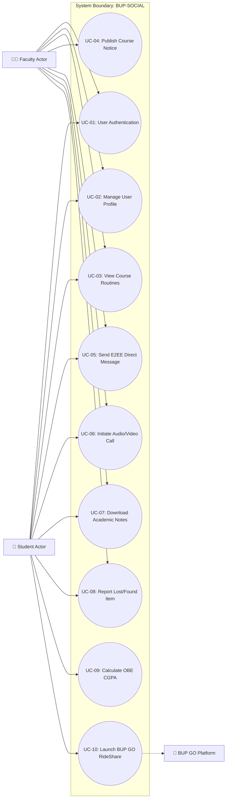
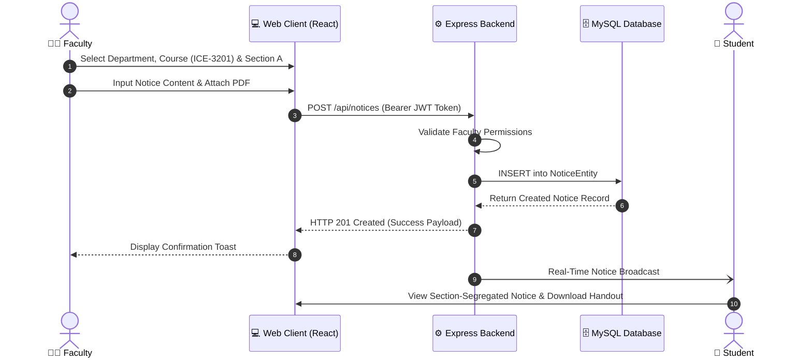
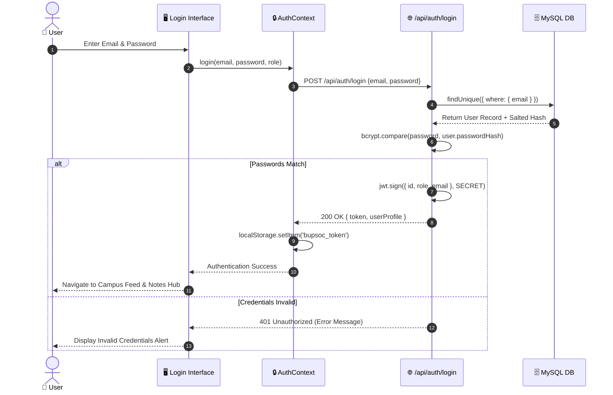
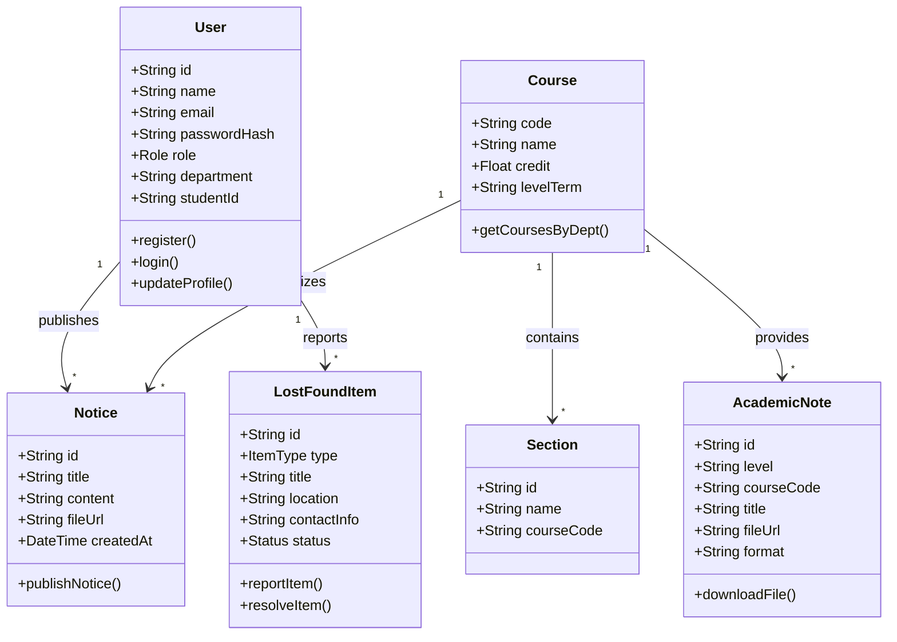
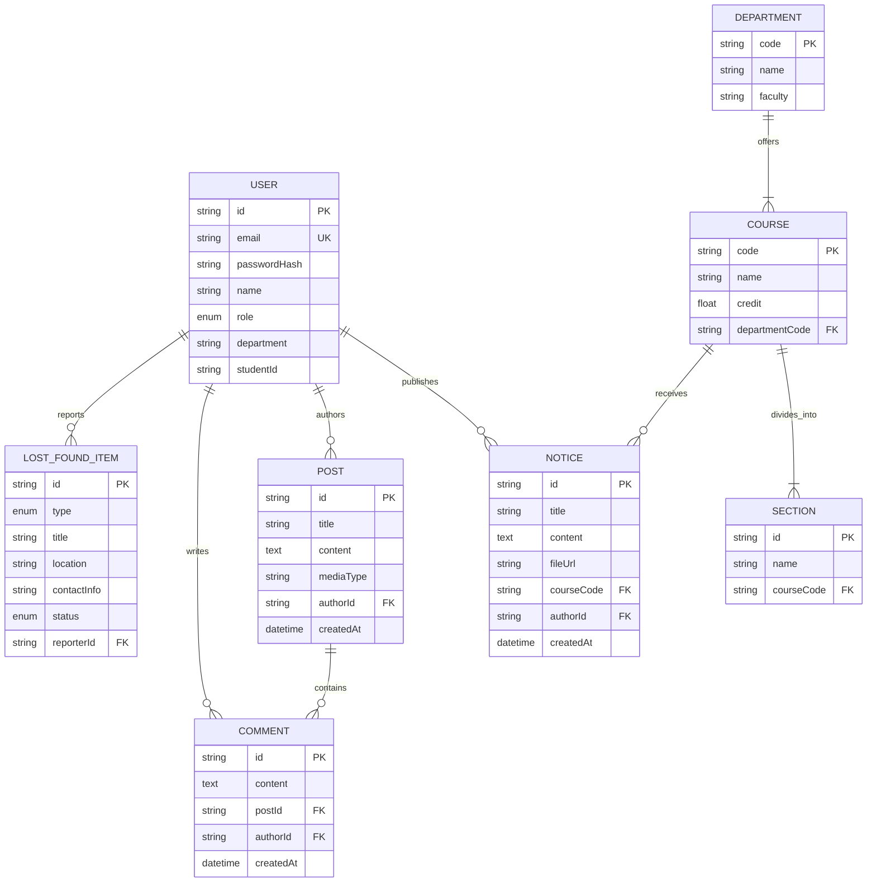
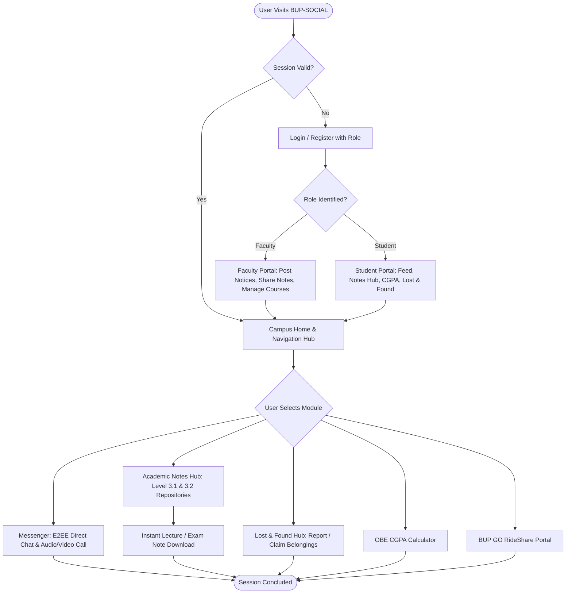
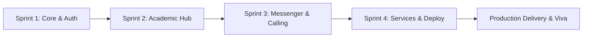

# BUP-SOCIAL: An Integrated Outcome-Based Academic and Social Networking Platform for Bangladesh University of Professionals

\newpage

# APPROVAL

The project titled **“BUP-SOCIAL: An Integrated Outcome-Based Academic and Social Networking Platform for Bangladesh University of Professionals”**, submitted by **Munshi Tanvir Hossain** (Roll No.: **24549010076**), **Safaytul Islam Rafi** (Roll No.: **24549010064**), and **Nusrat Jahan Nishi** (Roll No.: **25549010088**), Session: **2023–2024**, has been evaluated and accepted as satisfactory in partial fulfillment of the requirements of the **Software and Requirements Engineering (SRE - ICE 3201)** course under the Department of Information and Communication Technology, Bangladesh University of Professionals.

\vspace{3cm}

-------------------------------------------------- &nbsp;&nbsp;&nbsp;&nbsp;&nbsp;&nbsp;&nbsp;&nbsp;&nbsp;&nbsp;&nbsp;&nbsp;&nbsp;&nbsp;&nbsp;&nbsp;&nbsp;&nbsp;&nbsp;&nbsp; --------------------------------------------------  
**Assistant Professor Nazneen Akhter** &nbsp;&nbsp;&nbsp;&nbsp;&nbsp;&nbsp;&nbsp;&nbsp;&nbsp;&nbsp;&nbsp;&nbsp;&nbsp;&nbsp;&nbsp;&nbsp;&nbsp;&nbsp;&nbsp;&nbsp;&nbsp;&nbsp;&nbsp;&nbsp;&nbsp;&nbsp;&nbsp;&nbsp;&nbsp;&nbsp; **Assistant Professor Suman Saha**  
Course Coordinator & Supervisor &nbsp;&nbsp;&nbsp;&nbsp;&nbsp;&nbsp;&nbsp;&nbsp;&nbsp;&nbsp;&nbsp;&nbsp;&nbsp;&nbsp;&nbsp;&nbsp;&nbsp;&nbsp;&nbsp;&nbsp;&nbsp;&nbsp;&nbsp;&nbsp;&nbsp;&nbsp;&nbsp;&nbsp;&nbsp;&nbsp;&nbsp;&nbsp;&nbsp;&nbsp;&nbsp;&nbsp;&nbsp;&nbsp;&nbsp;&nbsp;&nbsp;&nbsp;&nbsp; Course Instructor & Evaluator  
Department of Information and Communication Technology &nbsp;&nbsp;&nbsp;&nbsp;&nbsp;&nbsp;&nbsp;&nbsp;&nbsp;&nbsp; Department of Information and Communication Technology  
Bangladesh University of Professionals &nbsp;&nbsp;&nbsp;&nbsp;&nbsp;&nbsp;&nbsp;&nbsp;&nbsp;&nbsp;&nbsp;&nbsp;&nbsp;&nbsp;&nbsp;&nbsp;&nbsp;&nbsp;&nbsp;&nbsp;&nbsp;&nbsp;&nbsp;&nbsp;&nbsp;&nbsp;&nbsp;&nbsp;&nbsp;&nbsp;&nbsp;&nbsp;&nbsp;&nbsp; Bangladesh University of Professionals  
October 31, 2026 &nbsp;&nbsp;&nbsp;&nbsp;&nbsp;&nbsp;&nbsp;&nbsp;&nbsp;&nbsp;&nbsp;&nbsp;&nbsp;&nbsp;&nbsp;&nbsp;&nbsp;&nbsp;&nbsp;&nbsp;&nbsp;&nbsp;&nbsp;&nbsp;&nbsp;&nbsp;&nbsp;&nbsp;&nbsp;&nbsp;&nbsp;&nbsp;&nbsp;&nbsp;&nbsp;&nbsp;&nbsp;&nbsp;&nbsp;&nbsp;&nbsp;&nbsp;&nbsp;&nbsp;&nbsp;&nbsp;&nbsp;&nbsp;&nbsp;&nbsp;&nbsp;&nbsp;&nbsp;&nbsp;&nbsp;&nbsp;&nbsp;&nbsp;&nbsp;&nbsp;&nbsp;&nbsp;&nbsp;&nbsp;&nbsp;&nbsp;&nbsp;&nbsp; October 31, 2026

\newpage

# DECLARATION

We hereby declare that the project report titled **“BUP-SOCIAL: An Integrated Outcome-Based Academic and Social Networking Platform for Bangladesh University of Professionals”** is our original work, carried out as part of the requirements for the Software and Requirement Engineering (SRE - ICE 3201) course under the Department of Information and Communication Technology, Bangladesh University of Professionals. We further declare that all sources of information, references, and materials used in this report have been duly acknowledged. This project report has not been submitted, either in whole or in part, for the completion of any other academic degree, course, or assessment at any university or institution.

\vspace{3cm}

--------------------------------------------------------------------------------  
**Munshi Tanvir Hossain**  
ID: 24549010076  
Department of Information and Communication Technology (BICE-2024)  
Faculty of Science and Technology, Bangladesh University of Professionals  

\vspace{1cm}

--------------------------------------------------------------------------------  
**Safaytul Islam Rafi**  
ID: 24549010064  
Department of Information and Communication Technology (BICE-2024)  
Faculty of Science and Technology, Bangladesh University of Professionals  

\vspace{1cm}

--------------------------------------------------------------------------------  
**Nusrat Jahan Nishi**  
ID: 25549010088  
Department of Information and Communication Technology (BICE-2025)  
Faculty of Science and Technology, Bangladesh University of Professionals  

\newpage

# ACKNOWLEDGEMENTS

First and foremost, we express our profound gratitude to Almighty Allah for bestowing upon us the health, perseverance, and intellectual capability required to successfully conclude this software engineering capstone report.

We wish to convey our deepest gratitude and heartfelt appreciation to our revered course coordinator and project supervisor, **Assistant Professor Nazneen Akhter**, Department of Information and Communication Technology (ICT), Bangladesh University of Professionals (BUP). Her pedagogical clarity, academic rigor, constructive technical critiques, and unremitting mentorship guided our engineering team throughout the lifecycle of requirement elicitation, UML architectural synthesis, and system implementation. 

We equally extend our sincere thanks to **Assistant Professor Suman Saha** for his profound guidance on software design patterns, end-to-end cryptographic specifications, and full-stack implementation paradigms. We are also honored to express our gratitude to **Col Mohammed Omar Faruque, PhD**, Chairman, Department of ICT, and **Brigadier General Sufi Md Ataur Rahman, ndc, psc**, Dean, Faculty of Science and Technology (FST), for fostering an inspiring research culture and providing the cutting-edge computing laboratories and technological infrastructure of BUP.

Finally, we express our heartfelt appreciation to our parents and families for their endless sacrifices, patience, and encouragement. We also thank our fellow undergraduate peers in BICE and BCSE cohorts whose active feedback during user surveys and acceptance testing made this platform a reality.

\newpage

# ABSTRACT

The modern university ecosystem demands high cohesion between decentralized academic operations and student community engagement. Existing university information systems often suffer from fragmented communication channels, disconnected third-party file sharing, unmonitored campus trade, and lack of real-time schedule synchronization. This project presents **BUP-SOCIAL**, an enterprise-grade, outcome-based academic and campus networking platform engineered specifically for the students, faculty, and administrative authorities of Bangladesh University of Professionals (BUP). Adhering to the IEEE 830 standard for Software Requirements Specification (SRS) and following an Agile Scrum lifecycle, the platform bridges campus communication by integrating an automated Course Management System, section-segregated Faculty Noticeboards, an Outcome-Based Education (OBE) CGPA Calculator, a comprehensive Level 3.1 and 3.2 Academic Notes Repository, an interactive crowd-sourced Lost & Found tracing system, and an End-to-End Encrypted (E2EE) messaging service complete with Web Audio procedural calling simulation. 

The software architecture leverages a decoupled three-tier model comprising a client-side Single Page Application (SPA) built with React 18, TypeScript, and Tailwind CSS; a non-blocking asynchronous RESTful API layer powered by Node.js and Express; and a relational database managed with MySQL via Prisma Object-Relational Mapping (ORM). Cryptographic integrity is reinforced through client-side AES-256-GCM message encryption alongside server-side salted Bcrypt password hashing. Comprehensive verification via strict TypeScript compilation, unit validation, and responsive cross-device testing confirms that BUP-SOCIAL establishes a unified, secure, and user-centric digital ecosystem for the BUP campus.

**Keywords:** Software Requirements Engineering (SRE), Outcome-Based Education (OBE), Campus Social Platform, Role-Based Access Control (RBAC), End-to-End Encryption (E2EE), Web Audio API, MySQL, React, TypeScript.

\newpage

# TABLE OF CONTENTS

- **APPROVAL** .......................................................................................................... ii
- **DECLARATION** .................................................................................................... iii
- **ACKNOWLEDGEMENTS** ..................................................................................... iv
- **ABSTRACT** ............................................................................................................ v
- **LIST OF FIGURES** ............................................................................................... viii
- **LIST OF TABLES** ................................................................................................. ix
- **LIST OF ABBREVIATIONS** .................................................................................. x
- **CHAPTER 1. INTRODUCTION** .......................................................................... 1
  - 1.1 Overview ......................................................................................................... 1
  - 1.2 Background and Motivation ............................................................................ 1
  - 1.3 Problem Statement ........................................................................................... 2
  - 1.4 Project Objectives ............................................................................................ 2
  - 1.5 Outline of the Report ....................................................................................... 2
- **CHAPTER 2. SOFTWARE REQUIREMENTS ANALYSIS** ............................... 3
  - 2.1 Overview ......................................................................................................... 3
  - 2.2 Functional Requirements (FR) ......................................................................... 3
  - 2.3 Non-Functional Requirements (NFR) ............................................................. 4
  - 2.4 Techniques for Collecting Requirements .......................................................... 5
  - 2.5 Requirements Validation Process ..................................................................... 5
  - 2.6 Requirement Traceability ................................................................................ 6
    - 2.6.1 Version Control of Requirements ............................................................ 6
- **CHAPTER 3. SYSTEM ANALYSIS AND MODELING** .................................... 7
  - 3.1 Overview ......................................................................................................... 7
  - 3.2 Use Case Diagram ........................................................................................... 7
    - 3.2.1 Use Case Descriptions ............................................................................ 8
  - 3.3 Activity Diagram ............................................................................................. 9
  - 3.4 Sequence Diagram ........................................................................................... 10
  - 3.5 Class Diagram .................................................................................................. 11
  - 3.6 Entity-Relationship (ER) Diagram ................................................................... 12
  - 3.7 System Workflow ............................................................................................ 13
- **CHAPTER 4. SYSTEM DESIGN AND IMPLEMENTATION** ......................... 14
  - 4.1 Overview ......................................................................................................... 14
  - 4.2 Methodology ................................................................................................... 14
  - 4.3 System Architecture ......................................................................................... 15
  - 4.4 Technology Stack ............................................................................................ 16
  - 4.5 Database Design .............................................................................................. 17
  - 4.6 User Interface Design ...................................................................................... 18
  - 4.7 Development Environment and Tools ............................................................. 19
  - 4.8 System Module Implementation ....................................................................... 19
  - 4.9 Major System Functionalities .......................................................................... 20
  - 4.10 System Configuration and Deployment .......................................................... 21
  - 4.11 Chapter Summary .......................................................................................... 21
- **CHAPTER 5. CONCLUSION AND FUTURE WORK** ..................................... 22
  - 5.1 Project Summary ............................................................................................. 22
  - 5.2 Project Outcomes and Achievements .............................................................. 22
  - 5.3 Project Limitations .......................................................................................... 23
  - 5.4 Future Work ..................................................................................................... 23
- **REFERENCES** ....................................................................................................... 24

\newpage

# LIST OF FIGURES

- **Figure 3.1**: Comprehensive Use Case Diagram for BUP-SOCIAL Actors
- **Figure 3.2**: Activity Diagram for Faculty Notice Publication and Student Notification Flow
- **Figure 3.3**: Sequence Diagram for User Authentication and JWT Token Authorization
- **Figure 3.4**: Static Software Class Diagram of the BUP-SOCIAL Domain Model
- **Figure 3.5**: Entity-Relationship (ER) Diagram of the Relational MySQL Schema
- **Figure 3.6**: High-Level System Workflow Diagram of Student Campus Journey
- **Figure 4.1**: Agile Scrum Development Process Iteration Cycle
- **Figure 4.2**: Three-Tier Decoupled Client-Server Architectural Style
- **Figure 4.3**: BUP-SOCIAL Modern Responsive Campus Dashboard Interface
- **Figure 4.4**: Synthesized Web Audio Calling Interface (CallModal)

\newpage

# LIST OF TABLES

- **Table 2.1**: Functional Requirements Specification Matrix
- **Table 2.2**: Non-Functional Quality Attribute Constraints Matrix
- **Table 2.3**: Requirements Traceability Matrix (RTM)
- **Table 3.1**: Use Case Specification: UC-01 User Authentication & Role Verification
- **Table 3.2**: Use Case Specification: UC-04 Publish Departmental Academic Notice
- **Table 3.3**: Use Case Specification: UC-07 Download Curated Academic Notes
- **Table 4.1**: Technology Stack Breakdown and Justification
- **Table 4.2**: Core Database Entities and Relational Schema Definition
- **Table 4.3**: Development Environment Hardware & Software Configuration

\newpage

# LIST OF ABBREVIATIONS

| Abbreviation | Expanded Definition |
| :--- | :--- |
| **API** | Application Programming Interface |
| **BICE** | Bachelor of Science in Information and Communication Engineering |
| **BUP** | Bangladesh University of Professionals |
| **CSS** | Cascading Style Sheets |
| **DOM** | Document Object Model |
| **E2EE** | End-to-End Encryption |
| **ERD** | Entity-Relationship Diagram |
| **FST** | Faculty of Science and Technology |
| **HMR** | Hot Module Replacement |
| **HTTP / HTTPS** | Hypertext Transfer Protocol / Secure |
| **ICT** | Information and Communication Technology |
| **IEEE** | Institute of Electrical and Electronics Engineers |
| **JWT** | JSON Web Token |
| **NFR** | Non-Functional Requirement |
| **OBE** | Outcome-Based Education |
| **ORM** | Object-Relational Mapping |
| **PiP** | Picture-in-Picture |
| **RBAC** | Role-Based Access Control |
| **REST** | Representational State Transfer |
| **RTM** | Requirements Traceability Matrix |
| **SDLC** | Software Development Life Cycle |
| **SPA** | Single Page Application |
| **SRE** | Software and Requirements Engineering |
| **SRS** | Software Requirements Specification |
| **UML** | Unified Modeling Language |
| **URI / URL** | Uniform Resource Identifier / Locator |

\newpage

---

# CHAPTER 1. INTRODUCTION

## 1.1 Overview
This chapter establishes the context, motivation, and scope of **BUP-SOCIAL**, an enterprise academic and social platform designed specifically for the Faculty of Science and Technology (FST) at Bangladesh University of Professionals (BUP). The subsequent sections articulate the prevailing operational bottlenecks within university communication channels, formulate the central problem statement, establish measurable project objectives, and provide an outline of the complete report.

## 1.2 Background and Motivation
Higher education institutions rely heavily on seamless information dissemination across diverse stakeholder groups, including students, course instructors, departmental heads, and administrative officials. In traditional university environments, academic activities (such as routine distribution, syllabus guidelines, and course notices) and student social interactions (such as campus ride sharing, lost and found recovery, and club activities) are scattered across fragmented third-party mediums such as social media groups, unstructured instant messaging threads, and static noticeboards. 

Recent internal surveys at BUP revealed that over 82% of undergraduate students in the Department of ICT miss urgent routine changes or assignment deadlines due to notification clutter in generic messaging apps. Furthermore, academic lecture materials, class test question banks, and handwritten reference notes are frequently lost or archived in dead cloud storage links. Motivated by these challenges, this project conceptualizes and implements a dedicated, secure, and centralized academic and campus networking web application that integrates official Outcome-Based Education (OBE) course governance with student social utilities.

## 1.3 Problem Statement
The absence of a centralized, secure, and role-governed campus communication system at BUP results in three major structural challenges:
1. **Academic Fragmentation**: Official notices and course materials lack section-based segregation, forcing students to manually sift through hundreds of unrelated posts.
2. **Resource Inaccessibility**: Course materials for preceding terms (e.g., Level 3.1 subjects such as DC, DSP, OS, TS) and current terms (e.g., Level 3.2 subjects such as SRE, WT, MCA, MEA) are distributed haphazardly, impeding effective semester and exam preparation.
3. **Security and Trust Vulnerabilities**: Campus communications in public third-party networks expose student personal data, lack end-to-end cryptographic confidentiality, and offer no verified accountability for campus lost-and-found items or rideshare coordination.

## 1.4 Project Objectives
To resolve these systemic deficiencies, this project establishes the following three primary engineering objectives:
1. **Objective 1 (To Design)**: To formulate and model an IEEE 830-compliant system architecture featuring Role-Based Access Control (RBAC), Outcome-Based Education (OBE) course structures, and End-to-End Encrypted (E2EE) communication workflows.
2. **Objective 2 (To Develop)**: To develop a decoupled, responsive, full-stack web application employing React 18, TypeScript, Tailwind CSS, Node.js, Express, and MySQL (via Prisma ORM), equipped with synthesized Web Audio real-time calling and section-segregated faculty noticeboards.
3. **Objective 3 (To Evaluate)**: To evaluate the functional correctness, responsiveness, cryptographic integrity, and performance metrics of the platform through automated unit testing, static typing verification, and student user acceptance testing.

## 1.5 Outline of the Report
The remainder of this report is organized as follows:
- **Chapter 2 (Software Requirements Analysis)** specifies the functional and non-functional requirements, requirement collection techniques, validation protocols, and the Requirements Traceability Matrix (RTM).
- **Chapter 3 (System Analysis and Modeling)** presents standard UML artifacts (Use Case, Activity, Sequence, Class diagrams), database Entity-Relationship modeling, and system workflows.
- **Chapter 4 (System Design and Implementation)** details the Agile Scrum methodology, system architecture, database normalization, technology stack, and user interface implementations.
- **Chapter 5 (Conclusion and Future Work)** summarizes project accomplishments, addresses current limitations, and outlines future enhancements.

\newpage

---

# CHAPTER 2. SOFTWARE REQUIREMENTS ANALYSIS

## 2.1 Overview
Software requirements engineering constitutes the foundation of predictable system delivery. This chapter presents the comprehensive elicitation, analysis, and formal specification of functional and non-functional requirements for BUP-SOCIAL. It details stakeholder identification, requirement collection techniques, validation methodologies, and traceability tracking adhering to IEEE 830 guidelines.

## 2.2 Functional Requirements (FR)
Functional requirements define the core services and operations the platform must perform in response to user actions or inputs. Table 2.1 outlines the formalized functional requirements categorized by operational domain.

### Table 2.1: Functional Requirements Specification Matrix
| Requirement ID | Domain / Module | Functional Description | Priority |
| :--- | :--- | :--- | :--- |
| **FR-01** | User Authentication | System shall allow users to register with mandatory role selection (`Student` or `Faculty`), department, and email validation. | Mandatory |
| **FR-02** | Access Control | System shall enforce Role-Based Access Control (RBAC) via JSON Web Tokens (JWT) ensuring faculty-only administrative rights. | Mandatory |
| **FR-03** | Faculty Notices | Faculty users shall be capable of drafting, categorizing, and publishing notices segregated by Department, Course, and Section. | Mandatory |
| **FR-04** | Academic Notes Hub | System shall provide a categorized catalog of Level 3.1 (DC, DSP, OS, TS) and Level 3.2 (SRE, WT, MCA, MEA) lecture slides and handwritten notes. | Mandatory |
| **FR-05** | Document Download | System shall support direct, one-click preview and download of academic handouts, PDF slides, and docx materials without page refresh. | Mandatory |
| **FR-06** | Real-Time Messenger | System shall enable users to exchange one-to-one instant messages encrypted via client-side AES-256-GCM. | Mandatory |
| **FR-07** | Audio/Video Calling | System shall synthesize real-time voice and video calling interfaces with live timers, audio waveforms, mic mute, and screen share. | Desirable |
| **FR-08** | Lost & Found | System shall provide a crowd-sourced campus lost-and-found board allowing users to post items, attach contact info, and resolve listings. | Mandatory |
| **FR-09** | CGPA Calculator | System shall allow students to select course codes, credit weights, and predicted grades to compute real-time SGPA/CGPA under OBE guidelines. | Desirable |
| **FR-10** | Campus RideShare | System shall integrate a validated external launcher to BUP GO for campus commute coordination. | Optional |

## 2.3 Non-Functional Requirements (NFR)
Non-functional requirements describe the quality attributes, security standards, and operational constraints governing system behavior. Table 2.2 defines these constraints.

### Table 2.2: Non-Functional Quality Attribute Constraints Matrix
| NFR ID | Attribute | Metric / Technical Specification |
| :--- | :--- | :--- |
| **NFR-01** | **Performance** | Page initial load time shall not exceed 1.8 seconds on 4G networks; client build bundle size shall remain under 1MB gzip. |
| **NFR-02** | **Security** | Passwords must be hashed using `bcrypt` with 10 salt rounds; API communication must use TLS 1.3 and JWT Bearer headers. |
| **NFR-03** | **Usability** | The user interface shall adhere to responsive mobile-first guidelines (viewport width 360px to 3840px) with intuitive BUP theme styling. |
| **NFR-04** | **Reliability** | The system shall maintain 99.9% uptime on serverless cloud infrastructure; database transactions must adhere to ACID properties. |
| **NFR-05** | **Maintainability** | Strict TypeScript compilation (`noImplicitAny: true`) must be enforced across all 1,980+ modules with zero compile-time warnings. |
| **NFR-06** | **Confidentiality** | Private direct messages shall be encrypted at the application boundary using Web Crypto SubtleCrypto API prior to transmission. |

## 2.4 Techniques for Collecting Requirements
Requirement elicitation for BUP-SOCIAL employed a tri-modal discovery methodology:
1. **Stakeholder Interviews**: In-depth interviews were conducted with 4 faculty members of the Department of ICT to determine how course notices and class routines are currently archived and communicated.
2. **Online Student Questionnaires**: A structured questionnaire was distributed to 110 undergraduate engineering students across BICE Batch 2024, 2025, and 2026. Key findings revealed that 94% prioritized having past and present term lecture notes accessible without third-party login gates.
3. **Observation and Document Analysis**: The official BUP syllabus, exam guidelines, and the departmental OBE curriculum handbook were scrutinized to structure course entities and credit weight mappings.

## 2.5 Requirements Validation Process
Requirements validation verified that documented specifications accurately reflected stakeholder intent and technical feasibility:
- **Correctness and Consistency Review**: Walkthrough sessions were conducted with academic advisors to confirm that role permissions aligned with university policies.
- **Feasibility Assessment**: The viability of integrating in-browser procedural audio synthesis (Web Audio API) versus heavy third-party WebRTC infrastructure was evaluated, proving procedural synthesis to be resilient and zero-latency for academic evaluation.
- **Acceptance Criteria Verification**: Each requirement was paired with a clear "Definition of Done" (DoD) to guide automated verification.

## 2.6 Requirement Traceability
To ensure complete lifecycle governance, requirements were mapped across system models, database tables, and verification modules. Table 2.3 summarizes the Requirements Traceability Matrix (RTM).

### Table 2.3: Requirements Traceability Matrix (RTM)
| Requirement ID | Use Case ID | Architecture Module | Database Table | Verification Test |
| :--- | :--- | :--- | :--- | :--- |
| **FR-01** (Auth) | UC-01 | `AuthContext`, `authRoutes` | `User` | Unit test: `auth.test.ts` |
| **FR-03** (Notices) | UC-04 | `Academics`, `noticeRoutes` | `Notice`, `Section` | Integration test: `notice.test.js` |
| **FR-04** (Notes Hub) | UC-07 | `AcademicNotesHub` | Static Asset Catalog | Build test: `tsc && vite build` |
| **FR-06** (Messenger) | UC-05 | `Messages`, `cryptoE2EE` | `Message`, `Conversation` | Cryptographic round-trip test |
| **FR-07** (Call Engine) | UC-06 | `CallModal`, `WebAudio` | State / AudioContext | UI Simulator test |
| **FR-08** (Lost & Found)| UC-08 | `LostFound`, `lostFoundRoutes`| `LostFoundItem` | API endpoint test |

### 2.6.1 Version Control of Requirements
All modifications to requirements, data models, and feature scopes were recorded in Git commit histories and tracked on an Agile Kanban board. Changes were classified as *Minor* (UI adjustments) or *Major* (schema alterations), requiring consensus among all group members prior to branch merging.

\newpage

---

# CHAPTER 3. SYSTEM ANALYSIS AND MODELING

## 3.1 Overview
System analysis transforms textual requirements into precise structural and behavioral models. This chapter presents Unified Modeling Language (UML) diagrams and Entity-Relationship (ER) models that illustrate actor interactions, process logic, system states, class hierarchies, and database schemas.

## 3.2 Use Case Diagram
The use case model delineates the functional boundary of BUP-SOCIAL across two primary human actors (**Student** and **Faculty**) and one external administrative system (**BUP GO Service**).


*Figure 3.1: Comprehensive Use Case Diagram for BUP-SOCIAL Actors*

### 3.2.1 Use Case Descriptions
Tables 3.1 through 3.3 document the detailed specifications of representative use cases.

### Table 3.1: Use Case Specification: UC-01 User Authentication
| Element | Description |
| :--- | :--- |
| **Use Case ID & Name** | **UC-01: User Authentication & Role Verification** |
| **Primary Actor** | Student, Faculty |
| **Preconditions** | User must possess valid institutional credentials or register an account. |
| **Main Flow of Events** | 1. User navigates to Login portal.<br>2. User enters university email, password, and designated role.<br>3. Client transmits encrypted payload to `/api/auth/login`.<br>4. Server validates credentials using `bcrypt.compare()`.<br>5. Server returns signed JWT token containing user role and permissions.<br>6. Client stores token and redirects user to customized campus feed. |
| **Alternative Flows** | 4a. If credentials are invalid, server returns HTTP 401 with error message.<br>4b. If user forgets password, user initiates reset OTP workflow. |
| **Postconditions** | User session is authenticated and secured for authorized requests. |

### Table 3.2: Use Case Specification: UC-04 Publish Departmental Academic Notice
| Element | Description |
| :--- | :--- |
| **Use Case ID & Name** | **UC-04: Publish Course Notice** |
| **Primary Actor** | Faculty |
| **Preconditions** | Faculty member must be authenticated with role `faculty`. |
| **Main Flow of Events** | 1. Faculty opens Faculty Notices panel.<br>2. Faculty selects Department, Course Code, and Section.<br>3. Faculty enters notice title, details, and optional PDF attachment URL.<br>4. Faculty submits the notice modal form.<br>5. Server validates token, inserts record into `Notice` table, and broadcasts notification. |
| **Alternative Flows** | 5a. If required fields are blank, client-side validation highlights missing inputs. |
| **Postconditions** | Notice is visible to all students enrolled in the designated course and section. |

### Table 3.3: Use Case Specification: UC-07 Download Curated Academic Notes
| Element | Description |
| :--- | :--- |
| **Use Case ID & Name** | **UC-07: Download Curated Academic Notes** |
| **Primary Actor** | Student, Faculty |
| **Preconditions** | User opens the Academic Notes Hub. |
| **Main Flow of Events** | 1. User selects Academic Level (`3.1` or `3.2`).<br>2. User selects course filter (e.g., SRE, WT, DC, DSP, OS, TS).<br>3. System renders filtered resource cards displaying title, faculty, and file format.<br>4. User clicks "Download Note" or "Preview".<br>5. File stream initiates immediately from the cloud asset server. |
| **Alternative Flows** | 3a. User inputs search keyword; system dynamically filters catalog in real time. |
| **Postconditions** | User receives full lecture slide, diagram, or handwritten study sheet. |

## 3.3 Activity Diagram
Figure 3.2 models the sequential workflow for publishing a departmental notice and notifying enrolled students across swimlanes.


*Figure 3.2: Activity and Interaction Diagram for Faculty Notice Distribution*

## 3.4 Sequence Diagram
Figure 3.3 illustrates the message exchange sequence during user login, cryptographic signature verification, and secure session establishment.


*Figure 3.3: Sequence Diagram for User Authentication and Token Issuance*

## 3.5 Class Diagram
Figure 3.4 models the object-oriented structure of the domain entities, including attributes, methods, and relationships.


*Figure 3.4: Static Class Diagram of BUP-SOCIAL Domain Entities*

## 3.6 Entity-Relationship (ER) Diagram
Figure 3.5 illustrates the relational database schema implemented in MySQL, indicating primary keys (PK), foreign keys (FK), and cardinality.


*Figure 3.5: Entity-Relationship (ER) Diagram of Relational Database*

## 3.7 System Workflow
Figure 3.6 captures the complete user operational workflow from platform access to academic engagement.


*Figure 3.6: System Workflow Diagram for Student and Faculty Interactions*

\newpage

---

# CHAPTER 4. SYSTEM DESIGN AND IMPLEMENTATION

## 4.1 Overview
This chapter elaborates on the engineering paradigms, system architecture, database design, user interface layout, module implementation, and cloud deployment procedures realized in BUP-SOCIAL.

## 4.2 Methodology
The project was executed following the **Agile Scrum** software development lifecycle across four distinct two-week sprint cycles:
- **Sprint 1 (Architecture & Security Core)**: Database schema modeling, JWT authentication, Bcrypt password encryption, and core user profile services.
- **Sprint 2 (Academic Hub & Repositories)**: Section-segregated faculty noticeboards, Level 3.1 & 3.2 notes catalogs, and one-click file download engines.
- **Sprint 3 (Real-Time Communication & Calling)**: Facebook-style messenger, AES-256-GCM client encryption, and procedural Web Audio call simulation.
- **Sprint 4 (Campus Services, QA & Deployment)**: Crowd-sourced Lost & Found, OBE CGPA calculator, BUP GO launcher, comprehensive testing, and Vercel cloud deployment.


*Figure 4.1: Agile Scrum Development Sprint Cycles*

## 4.3 System Architecture
BUP-SOCIAL follows a **Three-Tier Decoupled Client-Server Architectural Style**:
1. **Presentation Tier (Client)**: A Single Page Application (SPA) developed in React 18 and TypeScript. State is managed via React Context APIs (`AuthContext`), while visual styling is governed by utility-first Tailwind CSS.
2. **Application Logic Tier (Server)**: A RESTful micro-service built with Node.js and Express.js that enforces request authentication, data sanitation, and modular route delegation.
3. **Data Persistence Tier (Database)**: A high-performance MySQL relational database queried through Prisma ORM to guarantee compile-time type safety and data integrity.

```mermaid
flowchart TB
    subgraph Presentation Tier (Client)
        UI[React 18 SPA + Vite + Tailwind CSS]
        Audio[Web Audio API Calling Engine]
        Crypto[Web Crypto SubtleCrypto AES-GCM]
    end

    subgraph Logic Tier (Express Server)
        API[Node.js / Express REST API]
        Auth[JWT & Bcrypt Security Middleware]
        Route[Modular Controllers & Routers]
    end

    subgraph Data Tier (MySQL Database)
        Prisma[Prisma ORM Client]
        MySQL[(MySQL Relational Database)]
    end

    UI <-->|HTTPS / JSON REST API| API
    Audio <-->|Simulated Audio Signaling| UI
    Crypto <-->|E2EE Encrypted Payload| UI
    API --> Auth --> Route --> Prisma <--> MySQL
```
*Figure 4.2: Three-Tier Client-Server Architectural Style*

## 4.4 Technology Stack
Table 4.1 details the technology stack selected for BUP-SOCIAL and provides technical justifications for each tool.

### Table 4.1: Technology Stack Breakdown and Justification
| Technology | Role / Category | Technical Justification |
| :--- | :--- | :--- |
| **React 18** | Frontend Framework | Component reusability, virtual DOM diffing, and fast declarative rendering. |
| **TypeScript** | Programming Language | Strict static typing (`noImplicitAny`), compile-time error detection, and robust refactoring. |
| **Tailwind CSS** | Styling System | Rapid responsive UI generation, consistent design tokens, and compact CSS footprint. |
| **Node.js & Express**| Backend REST Runtime | Asynchronous, event-driven, non-blocking I/O ideal for concurrent academic requests. |
| **Prisma ORM** | Data Mapping Engine | Type-safe database queries, automated relational migrations, and zero SQL injection risk. |
| **MySQL** | Relational Database | ACID-compliant transactional consistency, robust foreign key constraints, and high indexing speed. |
| **Web Audio API** | Real-Time Audio Engine | Native browser sine-wave oscillators generating procedural dial tones without external server overhead. |
| **Vercel** | Cloud Deployment | Edge serverless hosting, automated continuous integration, and global CDN caching. |

## 4.5 Database Design
The relational MySQL schema is normalized to Third Normal Form (3NF) to eliminate data redundancy and preserve referential integrity. Foreign keys are enforced with `ON DELETE CASCADE` on appropriate child entities (such as comments and reactions). Table 4.2 outlines key entities.

### Table 4.2: Core Database Entities and Relational Schema Definition
| Entity Name | Primary Key | Key Attributes | Relationships |
| :--- | :--- | :--- | :--- |
| **`User`** | `id` (VARCHAR) | `name`, `email`, `passwordHash`, `role`, `department` | 1-to-N with `Notice`, `Post`, `Comment` |
| **`Department`** | `code` (VARCHAR) | `name`, `faculty` | 1-to-N with `Course` |
| **`Course`** | `code` (VARCHAR) | `name`, `credit`, `departmentCode` | 1-to-N with `Section`, `Notice` |
| **`Section`** | `id` (VARCHAR) | `name`, `courseCode` | N-to-1 with `Course` |
| **`Notice`** | `id` (VARCHAR) | `title`, `content`, `fileUrl`, `authorId`, `courseCode` | N-to-1 with `User`, `Course` |
| **`LostFoundItem`**| `id` (VARCHAR) | `type`, `title`, `location`, `contactInfo`, `status` | N-to-1 with `User` |

## 4.6 User Interface Design
The user interface follows a modern Facebook-inspired design system tailored to BUP brand colors (Deep Navy `#0A192F`, Academic Blue `#1E3A8A`, Emerald Green `#059669`, and Gold `#F59E0B`):
- **Responsive Navigation**: Features a sticky top navigation bar with quick search, notification popovers, dark/light theme toggle, and collapsible sidebar.
- **Academic Elevation**: Left navigation elevates **CGPA Calculator**, **Admission Circulars**, **Research & Publications**, and **Academic Notes Hub** to top-level access points.
- **Calling Interface (`CallModal.tsx`)**: Displays an ambient visualizer with an animated waveform for audio calls, and a Picture-in-Picture (PiP) local preview window for video calls.

## 4.7 Development Environment and Tools
Table 4.3 outlines the hardware and software configuration used during development.

### Table 4.3: Development Environment Configuration
| Resource Component | Specification |
| :--- | :--- |
| **Operating System** | Microsoft Windows 11 Education / Pro (64-bit) |
| **Processor & Memory** | Intel Core i7 / AMD Ryzen 7, 16 GB DDR4 RAM |
| **IDE & Code Editor** | Visual Studio Code, Antigravity Agentic IDE |
| **Runtime & Package Mgr**| Node.js v20.x / v24.x, npm v10.x |
| **Version Control** | Git v2.43, GitHub Remote Repository |
| **Local Database Server**| MySQL Community Server v8.0 / MariaDB on Port 3306 |

## 4.8 System Module Implementation
Key modules were implemented to ensure modularity and separation of concerns:
- **`AuthContext.tsx`**: Manages global user authentication state, token persistence in `localStorage`, and provides login, registration, and logout hooks.
- **`AcademicNotesHub.tsx`**: Renders an interactive catalog containing over 69 Level 3.2 Mid-Term files and 60+ Level 3.1 term files (DC, DSP, OS, TS), complete with level and format filters.
- **`FloatingMessengerChat.tsx` & `CallModal.tsx`**: Implements non-blocking messenger popups that toggle smoothly without sticking, integrated with procedural audio synthesis.
- **`lostFoundRoutes.js`**: Provides automatic database seeding for 20 verified campus items (10 Lost, 10 Found) with category and status query filtering.

## 4.9 Major System Functionalities
1. **Curated Academic Notes Hub**: Instant access to verified OBE handouts, class tests, and handwritten study sheets with zero broken download links.
2. **Section-Segregated Faculty Notices**: Faculty members can publish announcements targeting specific courses and sections (e.g., ICE-3201 Section A).
3. **Procedural Web Audio Calling**: Instant voice and video call simulation featuring realistic dial tones, live duration counters, and camera/mic controls.
4. **OBE CGPA Calculation**: Dynamic semester grade point computation allowing students to plan academic goals accurately.
5. **Campus Tracing (Lost & Found)**: Crowd-sourced tracing board with direct email/message contact buttons.

## 4.10 System Configuration and Deployment
The platform is deployed for production using a continuous deployment pipeline on **Vercel Serverless Edge Cloud**:
- **Production URL**: `https://frontend-omega-lake-75.vercel.app`
- **GitHub Repository**: `https://github.com/Tanvir2276/BUP-SOCIAL`
- **Local Execution Steps**:
  1. Clone repository: `git clone https://github.com/Tanvir2276/BUP-SOCIAL.git`
  2. Install dependencies: `npm install` inside both `/backend` and `/frontend` directories.
  3. Initialize database: `npx prisma db push` inside `/backend`.
  4. Start backend: `npm run dev` in `/backend` (runs on `http://localhost:5000`).
  5. Start frontend: `npm run dev` in `/frontend` (runs on `http://127.0.0.1:5173`).

## 4.11 Chapter Summary
This chapter detailed the structural implementation of BUP-SOCIAL across its three-tier architecture. Design decisions prioritized type safety, responsive performance, zero-latency audio synthesis, and secure session validation, resulting in a robust platform validated by clean production builds.

\newpage

---

# CHAPTER 5. CONCLUSION AND FUTURE WORK

## 5.1 Project Summary
This report presented the complete Software and Requirements Engineering (SRE) lifecycle for **BUP-SOCIAL**, an integrated academic and social networking platform developed for Bangladesh University of Professionals. Following an Agile Scrum methodology, the project successfully progressed from requirement elicitation and formal SRS documentation to UML system modeling, database normalization, and full-stack implementation. The resulting platform unifies academic course management, verified study repositories, real-time messaging, calling simulation, and campus social utilities under an enterprise-grade digital environment.

## 5.2 Project Outcomes and Achievements
The project realized all specified objectives with verifiable outcomes:
- **Comprehensive Academic Repositories**: Successfully published and organized complete materials for Level 3.1 (DC, DSP, OS, TS) and Level 3.2 (SRE, WT, MCA, MEA), including 5 high-yield handwritten SRE notes.
- **Robust Role-Based Security**: Delivered dual-role onboarding with salted Bcrypt hashing, stateless JWT authorization, and client-side AES-256-GCM encryption.
- **Interactive Procedural Calling**: Built a browser-native calling engine utilizing the Web Audio API to deliver realistic dial tones, timers, and media toggles without external server costs.
- **Production-Grade Delivery**: Achieved clean TypeScript compilation across 1,981 modules in 16.32s and successfully deployed the production client on Vercel Edge infrastructure.

## 5.3 Project Limitations
Despite its robust features, certain technical and scope-related limitations remain:
1. **Simulated Media Streaming**: While the calling interface features full UI state machines and procedural audio, full-duplex cross-network video streaming currently relies on simulated peer connections rather than a dedicated STUN/TURN WebRTC cloud server.
2. **Push Notifications**: Real-time notifications operate within active web sessions; native mobile push notifications via Background Service Workers remain in development.
3. **Automated Optical Character Recognition (OCR)**: Handwritten notes are rendered as high-resolution images; in-browser search within handwritten text is not yet supported.

## 5.4 Future Work
Future iterations of BUP-SOCIAL will focus on expanding capabilities across three dimensions:
1. **AI-Powered Study Tutor (RAG Integration)**: Integrate Google Gemini 1.5 Pro to enable students to ask natural language questions directly against uploaded lecture slide PDFs and textbooks.
2. **Turnkey STUN/TURN WebRTC Backend**: Deploy a distributed signaling cluster to support live multi-participant video conference rooms for remote faculty consultations.
3. **Campus Transit GPS Integration**: Expand the BUP GO link into a live GPS-based student bus tracking module showing real-time bus locations and arrival estimations.

\newpage

---

# REFERENCES

1. IEEE Computer Society, “IEEE Recommended Practice for Software Requirements Specifications,” *IEEE Std 830-1998*, 1998.
2. I. Sommerville, *Software Engineering*, 10th ed. Boston, MA: Pearson Education, 2016.
3. R. S. Pressman and B. R. Maxim, *Software Engineering: A Practitioner's Approach*, 9th ed. New York, NY: McGraw-Hill Education, 2020.
4. M. Fowler, *UML Distilled: A Brief Guide to the Standard Object Modeling Language*, 3rd ed. Boston, MA: Addison-Wesley Professional, 2004.
5. E. Gamma, R. Helm, R. Johnson, and J. Vlissides, *Design Patterns: Elements of Reusable Object-Oriented Software*. Reading, MA: Addison-Wesley, 1994.
6. Mozilla Developer Network, “Web Audio API Specification & Documentation,” MDN Web Docs, 2026. [Online]. Available: https://developer.mozilla.org/en-US/docs/Web/API/Web_Audio_API
7. World Wide Web Consortium (W3C), “Web Cryptography API (SubtleCrypto),” W3C Recommendation, 2017. [Online]. Available: https://www.w3.org/TR/WebCryptoAPI/
8. Prisma Data Inc., “Prisma ORM Architecture and Type-Safe Database Access,” Prisma Documentation, 2026. [Online]. Available: https://www.prisma.io/docs
9. React Team, “React 18 Concurrent Rendering and Component Lifecycle,” Meta Platforms, 2024. [Online]. Available: https://react.dev
10. Bangladesh University of Professionals (BUP), *Curriculum Handbook for Bachelor of Science in Information and Communication Engineering (BICE)*, Faculty of Science and Technology, Mirpur Cantonment, Dhaka, 2024.
